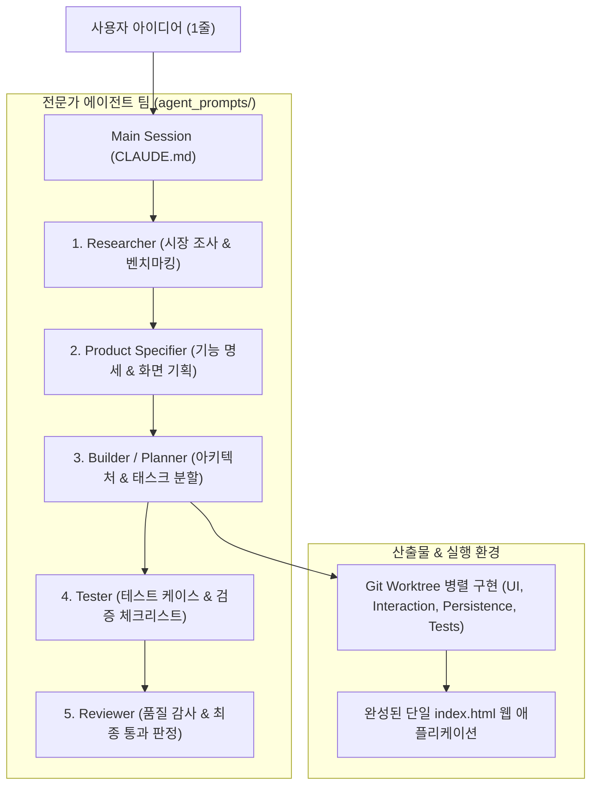

# 🤖 Multi-Agent Codex: AI 에이전트 팀 협업 및 Worktree 기반 고속 개발

본 저장소는 단 한 줄의 아이디어로부터 **5개의 전문 에이전트 팀(Researcher, Product Specifier, Builder/Planner, Tester, Reviewer)**이 협력하여 2~3시간 내에 단일 `index.html` 기반의 완성형 MVP를 설계·구현하는 멀티 에이전트 개발 워크플로우를 실습한 저장소입니다.

---

## 📌 1. 멀티 에이전트 파이프라인 및 아키텍처



---

## 📖 2. 주요 모듈 및 학습 내용

### 👥 1. `agent_teams` (MVP 아이디에이션 Starter Kit)
- **개념**: Claude Code CLI에서 5개 전문 페르소나 에이전트를 순차/병렬로 기동하여 요구사항을 구체화
- **에이전트 역할**:
  - `researcher.md`: 경쟁 서비스 분석 및 차별화 요소 도출
  - `product_specifier.md`: 유저 스토리, 화면 흐름, 핵심 인터랙션 명세
  - `builder_planner.md`: HTML/CSS/JS 구조화, 컴포넌트 설계 및 작업 분할
  - `tester.md`: 경계값, 크로스 브라우징, 사용성 테스트 케이스 작성
  - `reviewer.md`: 접근성, 성능, 디자인 일관성 검토
- **Git Worktree 협업 패턴**:
  - `wt-ui`: 화면 레이아웃 및 스타일링
  - `wt-interaction`: 사용자 이벤트 및 애니메이션 제어
  - `wt-persistence`: LocalStorage / IndexedDB 상태 저장소 구현
  - `wt-tests`: 단위 테스트 및 검증 스크립트 작성

### 🎛️ 2. `practice3_mx_issue_console_starter`
- **개념**: 사내 MX 이슈 콘솔 웹 애플리케이션을 여러 전문 태스크로 쪼개어 자동 구현 및 검증
- **주요 파일**:
  - `server.py`: 경량 로컬 API 서빙
  - `scripts/`: `check_api.py`, `check_dom.py`, `audit.py`를 통한 DOM 및 API 계약 검증
  - `tasks/`: 백엔드, 프론트엔드, 통합, 테스터 역할별 태스크 명세

---

## 🗂️ 3. 저장소 디렉토리 구조 (권장 배포 구조)

> **주의 (제외 항목)**: 중복 zip 파일(`agent_teams.zip`, `practice3_*.zip`)과 단순 텍스트 테스트 더미 폴더(`testproject/`)는 제외합니다.

```text
study_multi_agent_codex/
├── README.md                           # 전체 워크플로우 가이드 (본 문서)
├── agent_teams/                        # 멀티 에이전트 스타터 키트
│   ├── CLAUDE.md                       # 메인 오케스트레이션 규칙
│   ├── agent_prompts/                  # 5대 전문 에이전트 프롬프트
│   │   ├── researcher.md
│   │   ├── product_specifier.md
│   │   ├── builder_planner.md
│   │   ├── tester.md
│   │   └── reviewer.md
│   ├── docs/                           # 에이전트들이 도출한 기획/설계 문서
│   └── index.html                      # 최종 완성된 MVP 웹 앱
└── practice_issue_console/             # 실습 3: MX 이슈 콘솔
    ├── server.py                       # Python 목업 백엔드 서버
    ├── index.html                      # 콘솔 UI 화면
    ├── tasks/                          # 세부 역할별 태스크 정의
    └── scripts/                        # DOM/API 자동 검증기
```

---

## 💡 4. 멀티 에이전트 협업의 핵심 교훈

1. **역할 분리와 단일 책임**: 하나의 LLM 세션에 모든 책임을 맡기지 않고, 명확한 페르소나와 입출력 계약(Contract)을 통해 환각(Hallucination) 방지 및 품질 극대화.
2. **Git Worktree 활용**: 메인 코드베이스를 건드리지 않고 브랜치별 독립 작업 트리를 격리 생성하여, 충돌 없이 병렬 구현 후 병합.
3. **자동화된 계약 검증(Audit Script)**: 사람이 육안으로 확인하기 전 Python 자동 검증 스크립트로 DOM 노드와 API 응답을 1차 검증하여 개발 속도 3배 가속.
